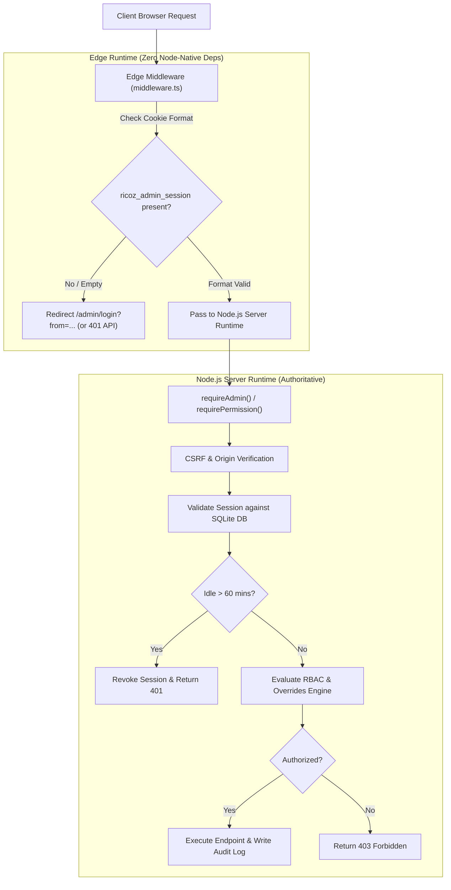

# RICOZ Enterprise Admin Security, Authentication & Granular RBAC Documentation
**Platform:** RICOZ Creative Talent Discovery & Enterprise Operations Platform  
**Version:** 3.2.0 (Phase 1 & Phase 2 Complete)  
**Classification:** Internal Confidential / System Architecture Manual  
**Last Updated:** November 2026

---

## Executive Summary

This document details the enterprise-grade security architecture, server-side authentication engine, 10-department organizational boundary system, and 13-tier database-backed Role-Based Access Control (RBAC) engine implemented inside RICOZ.

Both **Phase 1** (Edge Route Protection, Authentication & Security Hardening) and **Phase 2** (Department Expansion, Granular RBAC, Permission Overrides & Organizational Governance) are fully implemented, verified with 67 automated test assertions, and verified in production Next.js 15.5 builds.

---

## 1. Authentication Architecture

The administrative portal (`/admin`) employs a defense-in-depth security model:



### Key Security Properties:
1. **Zero Node Imports in Edge Middleware:** Edge `middleware.ts` performs only lightweight cookie existence/format verification and redirects unauthenticated users before client bundles render.
2. **Authoritative Node.js Server Authorization:** All database lookups, password verifications, session validations, and permission checks are strictly executed in the Node.js server runtime.
3. **No Client-Side Authorization Trust:** UI navigation filtering is strictly cosmetic. Every state-changing and read operation is independently authorized on the server.

---

## 2. Session Lifecycle & Security

Sessions are cryptographically managed and tracked in the `admin_sessions` table.

| Metric | Specification | Enforcement Mechanism |
|---|---|---|
| **Max Lifetime** | 7 Days (168 hours) | Hard database cutoff (`expires_at`) |
| **Idle Timeout** | 60 Minutes | Sliding check on `last_activity_at` |
| **Activity Update Throttle** | 5 Minutes | Prevents DB write amplification |
| **Token Entropy** | 256-bit (64 hex characters) | `crypto.randomBytes(32)` |
| **Cookie Flags** | `HttpOnly; Secure; SameSite=Lax; Path=/` | Browser storage isolation |
| **Explicit Revocation** | Supported | Individual session or all user sessions |
| **Cascade Revocation** | Immediate | Triggered on account suspension or role changes |

---

## 3. Brute-Force Rate Limiting Architecture

Administrative login endpoints are protected against credential stuffing and brute-force attacks via `lib/admin/rateLimit.ts`:

- **Tracking Identifier:** Composite key of `IP Address` + `Normalized Email` (`email.trim().toLowerCase()`).
- **Casing Bypass Prevention:** Capitalization variances (e.g. `Admin@ricoz.io` vs `admin@ricoz.io`) resolve to the exact same rate limit bucket.
- **Threshold:** Maximum 5 failed attempts within a 15-minute sliding window.
- **Lockout Duration:** 15 minutes temporary lockout.
- **Response:** HTTP 429 Too Many Requests with `Retry-After: 900` header and descriptive JSON error.
- **Extensibility:** Implemented with a modular interface allowing drop-in replacement with Redis/Upstash for multi-instance deployments.

---

## 4. CSRF and Origin Protection

All state-changing administrative operations (`POST`, `PUT`, `PATCH`, `DELETE`) are guarded against Cross-Site Request Forgery via `lib/admin/csrf.ts`:

- Safe read-only methods (`GET`, `HEAD`, `OPTIONS`) bypass origin verification.
- Incoming `Origin` (or fallback `Referer`) is parsed and matched against the server's `Host` / `X-Forwarded-Host`.
- Cross-origin mutations from untrusted origins are immediately terminated with HTTP 403 Forbidden.
- Production environments reject mutating requests lacking Origin/Referer headers.

---

## 5. Organizational Department Structure

All 6 original departments are preserved, and 4 new departments have been idempotently created in `data/ricoz_admin.db`:

| Department ID | Department Name | Slug | Purpose & Operational Scope |
|---|---|---|---|
| `dept-ops` | Operations | `operations` | Platform workflows, vetting, quality standards, day-to-day delivery |
| `dept-tech` | Technology | `technology` | Platform engineering, AI engine, infrastructure, security audits |
| `dept-sales` | Sales & Partnerships | `sales` | Enterprise client intake, project scoping, commercial retainers |
| `dept-marketing` | Marketing | `marketing` | Brand communication, editorial showcase publishing, community |
| `dept-hr` | People & Talent Ops | `hr` | Internal team recruiting, capacity allocation, culture |
| `dept-support` | Customer Support | `support` | Client onboarding success, creative dispute resolution, service quality |
| `dept-exec` | Executive Management | `executive` | Strategic direction, governance, enterprise capital allocation |
| `dept-finance` | Finance & Accounts | `finance` | Escrow disbursements, client invoicing, treasury, financial audits |
| `dept-ai` | AI & Automation | `ai-automation` | Creative knowledge taxonomy, AI matching algorithms, automated analyzers |
| `dept-qa` | Quality Assurance | `quality-assurance` | Creative deliverable review, portfolio vetting standards, platform QA |

---

## 6. Thirteen-Tier Organizational Role Hierarchy

The administrative permission engine supports a 13-tier role hierarchy (+ Auditor):

```
Level 1:  Owner / Super Admin (super_admin) — Unrestricted platform authority
Level 2:  Executive Director (exec_director) — Cross-department governance & strategy
Level 3:  Chief Operations Officer (coo) — End-to-end platform operations & delivery
Level 4:  Department Head (dept_head) — Functional lead of assigned department
Level 5:  Operations Manager (ops_manager / ops_admin) — Workflow tracking & vendor vetting
Level 6:  Finance Manager (finance_manager) — Invoicing, escrow, and financial reporting
Level 7:  HR Manager (hr_manager) — Team recruiting, memberships, capacity
Level 8:  Sales Manager (sales_manager) — Client intake, scoping, mandating
Level 9:  Marketing Manager (marketing_manager) — Website editorial, content publishing
Level 10: Technology Manager (tech_manager) — Platform infrastructure, tech audits, AI
Level 11: AI & Automation Manager (ai_manager) — AI matching engine, taxonomy, benchmarks
Level 12: Quality Assurance Manager (qa_manager) — Deliverable review, dispute triage
Level 13: Team Member (team_member) — Individual contributor on assigned tasks & tickets
Level 14: Auditor (auditor) — Strict read-only inspection across all modules & logs
```

---

## 7. Permission Catalogue & Evaluation Rules

### Evaluation Order (Deterministic Precedence):
1. **Authentication Check:** Session must be active and valid.
2. **Account Status Check:** Suspended accounts return `false` immediately.
3. **Super Admin Bypass:** Level 1 (`super_admin`) is unconditionally granted access.
4. **Explicit User DENY:** If user has an active `admin_user_permissions` record with `effect = 'deny'`, access is **DENIED** immediately (overrides inherited role permissions).
5. **Explicit User ALLOW:** If user has an active `admin_user_permissions` record with `effect = 'allow'`, permission is granted (subject to department scope).
6. **Role Permissions:** Checks `admin_role_permissions` for the user's assigned role.
7. **Department Boundaries:** If request is scoped to a specific department (`context.departmentId`), global roles pass; other roles must be assigned to that department.
8. **Default Deny:** If no rule matches, access is strictly denied.

---

## 8. Master Permission Matrix

| Module / Permission Slug | Super Admin | COO / Ops Admin | Dept Head | Finance Mgr | Sales Mgr | Marketing Mgr | Tech / AI Mgr | QA Mgr | Team Member | Auditor |
|---|:---:|:---:|:---:|:---:|:---:|:---:|:---:|:---:|:---:|:---:|
| `dashboard.view` | ✅ | ✅ | ✅ | ✅ | ✅ | ✅ | ✅ | ✅ | ✅ | ✅ |
| `dashboard.view_company_metrics` | ✅ | ✅ | — | ✅ | — | — | — | — | — | ✅ |
| `users.view` | ✅ | ✅ | ✅ | — | — | — | — | — | — | ✅ |
| `users.create` | ✅ | ✅ | — | — | — | — | — | — | — | — |
| `users.edit` | ✅ | ✅ | — | — | — | — | — | — | — | — |
| `users.suspend` | ✅ | — | — | — | — | — | — | — | — | — |
| `users.assign_roles` | ✅ | ✅ | — | — | — | — | — | — | — | — |
| `users.manage_permissions` | ✅ | — | — | — | — | — | — | — | — | — |
| `departments.view` | ✅ | ✅ | ✅ | ✅ | ✅ | ✅ | ✅ | ✅ | ✅ | ✅ |
| `departments.create` | ✅ | — | — | — | — | — | — | — | — | — |
| `departments.edit` | ✅ | — | — | — | — | — | — | — | — | — |
| `departments.manage_members` | ✅ | ✅ | ✅ | — | — | — | — | — | — | — |
| `departments.assign_head` | ✅ | ✅ | — | — | — | — | — | — | — | — |
| `tasks.view` | ✅ | ✅ | ✅ | ✅ | ✅ | ✅ | ✅ | ✅ | ✅ | ✅ |
| `tasks.create` | ✅ | ✅ | ✅ | — | ✅ | ✅ | ✅ | — | — | — |
| `tasks.edit` | ✅ | ✅ | ✅ | — | ✅ | ✅ | ✅ | ✅ | ✅* | — |
| `tasks.delete` | ✅ | ✅ | — | — | — | — | ✅ | — | — | — |
| `tasks.assign` | ✅ | ✅ | ✅ | — | — | — | ✅ | — | — | — |
| `tasks.approve` | ✅ | ✅ | ✅ | — | — | — | — | ✅ | — | — |
| `tasks.export` | ✅ | ✅ | ✅ | — | — | — | — | — | — | ✅ |
| `clients.view` | ✅ | ✅ | ✅ | ✅ | ✅ | — | — | — | ✅ | ✅ |
| `clients.create` | ✅ | ✅ | — | — | ✅ | — | — | — | — | — |
| `clients.edit` | ✅ | ✅ | ✅ | — | ✅ | — | — | — | — | — |
| `clients.delete` | ✅ | — | — | — | — | — | — | — | — | — |
| `clients.assign` | ✅ | ✅ | — | — | ✅ | — | — | — | — | — |
| `clients.export` | ✅ | ✅ | — | ✅ | ✅ | — | — | — | — | ✅ |
| `vendors.view` | ✅ | ✅ | ✅ | ✅ | — | — | — | ✅ | ✅ | ✅ |
| `vendors.create` | ✅ | ✅ | — | — | — | — | — | — | — | — |
| `vendors.edit` | ✅ | ✅ | ✅ | — | — | — | — | ✅ | — | — |
| `vendors.delete` | ✅ | — | — | — | — | — | — | — | — | — |
| `vendors.approve` | ✅ | ✅ | — | — | — | — | — | ✅ | — | — |
| `vendors.export` | ✅ | ✅ | — | ✅ | — | — | — | — | — | ✅ |
| `support.view` | ✅ | ✅ | ✅ | — | — | — | — | ✅ | ✅ | ✅ |
| `support.create` | ✅ | ✅ | — | — | — | — | — | — | ✅ | — |
| `support.edit` | ✅ | ✅ | ✅ | — | — | — | — | ✅ | ✅ | — |
| `support.assign` | ✅ | ✅ | — | — | — | — | — | — | — | — |
| `support.resolve` | ✅ | ✅ | ✅ | — | — | — | — | — | — | — |
| `support.export` | ✅ | ✅ | — | — | — | — | — | — | — | ✅ |
| `sops.view` | ✅ | ✅ | ✅ | ✅ | ✅ | ✅ | ✅ | ✅ | ✅ | ✅ |
| `sops.create` | ✅ | ✅ | ✅ | — | — | — | ✅ | — | — | — |
| `sops.edit` | ✅ | ✅ | ✅ | — | — | — | ✅ | — | — | — |
| `sops.delete` | ✅ | — | — | — | — | — | — | — | — | — |
| `sops.approve` | ✅ | ✅ | ✅ | — | — | — | — | — | — | — |
| `sops.publish` | ✅ | ✅ | ✅ | — | — | — | — | — | — | — |
| `reports.view` | ✅ | ✅ | ✅ | ✅ | ✅ | ✅ | ✅ | ✅ | — | ✅ |
| `reports.export` | ✅ | ✅ | — | ✅ | ✅ | — | — | — | — | ✅ |
| `reports.view_financial` | ✅ | ✅ | — | ✅ | — | — | — | — | — | ✅ |
| `notifications.view` | ✅ | ✅ | ✅ | ✅ | ✅ | ✅ | ✅ | ✅ | ✅ | ✅ |
| `notifications.create` | ✅ | ✅ | — | — | — | — | — | — | — | — |
| `notifications.manage` | ✅ | ✅ | ✅ | — | — | — | — | — | — | — |
| `audit_logs.view` | ✅ | ✅ | — | — | — | — | ✅ | — | — | ✅ |
| `audit_logs.export` | ✅ | — | — | — | — | — | — | — | — | ✅ |
| `website_content.view` | ✅ | ✅ | — | — | — | ✅ | — | — | — | ✅ |
| `website_content.create` | ✅ | — | — | — | — | ✅ | — | — | — | — |
| `website_content.edit` | ✅ | — | — | — | — | ✅ | — | — | — | — |
| `website_content.publish`| ✅ | — | — | — | — | ✅ | — | — | — | — |
| `talent.view` | ✅ | ✅ | ✅ | — | — | ✅ | — | — | — | ✅ |
| `talent.create` | ✅ | — | — | — | — | — | — | — | — | — |
| `talent.edit` | ✅ | — | — | — | — | — | — | — | — | — |
| `talent.approve` | ✅ | ✅ | — | — | — | — | — | — | — | — |
| `talent.archive` | ✅ | — | — | — | — | — | — | — | — | — |
| `ai_matcher.view` | ✅ | ✅ | — | — | — | — | ✅ | — | — | ✅ |
| `ai_matcher.manage` | ✅ | — | — | — | — | — | ✅ | — | — | — |

*\*Note: Team Members can only edit tasks assigned to them or created by them.*

---

## 9. Database Schema Enhancements

### New Tables Added in Migration 001:

```sql
-- 1. Versioned Schema Tracking
CREATE TABLE IF NOT EXISTS schema_migrations (
  id TEXT PRIMARY KEY,
  version INTEGER NOT NULL UNIQUE,
  name TEXT NOT NULL,
  applied_at TEXT NOT NULL
);

-- 2. System Roles
CREATE TABLE IF NOT EXISTS admin_roles (
  id TEXT PRIMARY KEY,
  name TEXT NOT NULL,
  slug TEXT UNIQUE NOT NULL,
  description TEXT NOT NULL,
  hierarchy_level INTEGER NOT NULL,
  is_system_role INTEGER NOT NULL DEFAULT 1,
  is_active INTEGER NOT NULL DEFAULT 1,
  created_at TEXT NOT NULL,
  updated_at TEXT NOT NULL
);

-- 3. Granular Permissions
CREATE TABLE IF NOT EXISTS admin_permissions (
  id TEXT PRIMARY KEY,
  name TEXT NOT NULL,
  slug TEXT UNIQUE NOT NULL,
  description TEXT NOT NULL,
  module TEXT NOT NULL,
  action TEXT NOT NULL,
  created_at TEXT NOT NULL
);

-- 4. Role Permission Mappings
CREATE TABLE IF NOT EXISTS admin_role_permissions (
  id TEXT PRIMARY KEY,
  role_id TEXT NOT NULL REFERENCES admin_roles(id) ON DELETE CASCADE,
  permission_id TEXT NOT NULL REFERENCES admin_permissions(id) ON DELETE CASCADE,
  created_at TEXT NOT NULL,
  UNIQUE(role_id, permission_id)
);

-- 5. User-Level Explicit Permission Overrides
CREATE TABLE IF NOT EXISTS admin_user_permissions (
  id TEXT PRIMARY KEY,
  admin_user_id TEXT NOT NULL REFERENCES admin_users(id) ON DELETE CASCADE,
  permission_id TEXT NOT NULL REFERENCES admin_permissions(id) ON DELETE CASCADE,
  effect TEXT NOT NULL CHECK(effect IN ('allow', 'deny')),
  granted_by TEXT REFERENCES admin_users(id) ON DELETE SET NULL,
  reason TEXT NOT NULL,
  expires_at TEXT,
  created_at TEXT NOT NULL,
  UNIQUE(admin_user_id, permission_id)
);

-- 6. Department Memberships
CREATE TABLE IF NOT EXISTS admin_department_members (
  id TEXT PRIMARY KEY,
  admin_user_id TEXT NOT NULL REFERENCES admin_users(id) ON DELETE CASCADE,
  department_id TEXT NOT NULL REFERENCES departments(id) ON DELETE CASCADE,
  membership_role TEXT NOT NULL DEFAULT 'member',
  is_primary INTEGER NOT NULL DEFAULT 0,
  created_at TEXT NOT NULL,
  UNIQUE(admin_user_id, department_id)
);
```

---

## 10. Audit Logging Specification

Every privileged action records an immutable audit trail in `audit_logs`:
- **Actor ID, Name & Role**
- **Action Type** (e.g. `USER_LOGIN`, `USER_LOGOUT`, `LOGIN_FAILED`, `LOGIN_RATE_LIMITED`, `USER_CREATE`, `USER_UPDATE`, `USER_DELETE`, `SESSION_REVOKED`, `PERMISSION_OVERRIDE_SET`, `DEPARTMENT_HEAD_ASSIGNED`, `TASK_UPDATED`, `TASK_DELETED`, `VENDOR_DOCUMENT_VERIFIED`, `CLIENT_UPDATED`)
- **Entity Type & Entity ID**
- **Change Summary**
- **Client IP Address**
- **ISO 8601 Timestamp**

Plaintext passwords, raw tokens, and secret keys are strictly stripped before audit writing.

---

## 11. Security Configuration & Production Readiness Checklist

| Setting / Control | Dev Value | Production Value | Status |
|---|---|---|---|
| `SESSION_COOKIE_NAME` | `ricoz_admin_session` | `ricoz_admin_session` | Enforced |
| `Cookie.Secure` | `false` | `true` (HTTPS) | Enforced |
| `Cookie.HttpOnly` | `true` | `true` | Enforced |
| `Cookie.SameSite` | `lax` | `lax` | Enforced |
| `Idle Timeout` | 60 minutes | 60 minutes | Enforced |
| `Max Session Duration`| 7 days | 7 days | Enforced |
| `Rate Limiting` | 5 fails / 15 mins | 5 fails / 15 mins | Enforced |
| `Dev Login Shortcuts` | Off by default | Strictly disabled | Enforced |
| `Edge Middleware` | Intercepts `/admin/*` | Intercepts `/admin/*` | Enforced |
| `Content-Security-Policy`| Active | Active | Enforced |
| `Frame Protection` | `DENY` | `DENY` | Enforced |

---

## 12. Verification and Test Results

Automated test verification executed via `scratch/test_admin_phase1_phase2.ts`:
- **Total Test Cases:** 67 assertions
- **Passed:** 67 (100%)
- **Failed:** 0
- **Regression Suite:** Legacy suite (`scratch/test_admin_suite.ts`) 20/20 passed.
- **Production Build:** `npm run build` compiled 60/60 routes cleanly with 0 TypeScript or linting errors.
