# RICOZ — Complete Platform Functionality, Admin Panel & Database Integration Report

**Date:** November 19, 2026  
**Project:** RICOZ Platform  
**Target Environment:** Next.js 15.5.27 (App Router), React 19, Tailwind CSS, InsForge PostgreSQL BaaS  
**Verification Status:** Built Successfully (79/79 pages statically optimized and dynamically rendered with 0 TypeScript/build errors)

---

## Executive Summary

RICOZ has transitioned from a dual-state application reliant on disconnected browser mock data into an interconnected, unified web platform. All four primary tiers—**Public Website**, **Creative Talent Studio**, **Enterprise Company Workspace**, and the **Admin Operations Suite**—now actively read from and write to the same authoritative InsForge PostgreSQL database.

The implementation preserves the luxury editorial visual identity and Next.js 15 App Router architecture while replacing client-isolated state with database-backed workflows, real-time status validation, cross-user messaging, portfolio bookmarking, mandate publishing, proposal submissions, and administrative platform governance.

---

## 1. System Architecture & Database Cohesion

The RICOZ platform uses a unified PostgreSQL schema managed by InsForge. Every user, mandate, interaction, and administrative action is recorded in relational database tables.

```mermaid
flowchart TD
    subgraph Public Website
        PW1["Homepage / Explore Talent"]
        PW2["Start Project Wizard (/start-project)"]
        PW3["Public Talent Profile (/designers/[id])"]
    end

    subgraph Authentication & Sessions
        AUTH1["/api/auth/register & /verify-email"]
        AUTH2["/api/auth/login & /me"]
        AUTH3["Fail-Closed HMAC-SHA256 Session Cookie"]
    end

    subgraph Database Tier ["InsForge PostgreSQL BaaS"]
        DB_USERS["public.user_profiles"]
        DB_TALENT["public.talent_profiles"]
        DB_COMPANY["public.company_profiles"]
        DB_PROJECTS["public.client_projects"]
        DB_APPS["public.project_applications"]
        DB_SHORTLIST["public.user_shortlists"]
        DB_CONV["public.conversations & messages"]
        DB_ENQ["public.website_enquiries"]
        DB_ADMIN["public.admin_users & audit_logs"]
    end

    subgraph Talent Studio
        TS1["Studio Overview (/dashboard/designer)"]
        TS2["Profile Editor (/dashboard/designer/profile)"]
        TS3["Opportunities (/dashboard/designer/opportunities)"]
        TS4["Messages (/dashboard/designer/messages)"]
    end

    subgraph Company Workspace
        CW1["Company Overview (/dashboard/company)"]
        CW2["New Brief Wizard (/dashboard/company/projects/new)"]
        CW3["Shortlist Drawer (/dashboard/company/shortlist)"]
        CW4["Messages (/dashboard/company/messages)"]
    end

    subgraph Admin Operations
        ADM1["Command Center (/admin)"]
        ADM2["Platform User Management (/admin/users)"]
        ADM3["Audit Log (/admin/audit-log)"]
        ADM4["Enquiries & CRM (/admin/website, /admin/clients)"]
    end

    PW2 -->|Persists Brief| DB_PROJECTS
    PW2 -->|Dual-syncs Mandate| DB_ENQ
    PW3 -->|Initiates Thread| DB_CONV
    PW1 -->|Bookmarks| DB_SHORTLIST

    AUTH1 --> DB_USERS
    AUTH1 --> DB_TALENT
    AUTH1 --> DB_COMPANY
    AUTH2 --> AUTH3

    TS2 <-->|GET / PATCH /api/user/profile| DB_TALENT
    TS3 -->|POST /api/user/applications| DB_APPS
    TS4 <-->|Conversations & Messages API| DB_CONV

    CW2 -->|POST /api/user/projects| DB_PROJECTS
    CW3 <-->|GET / DELETE /api/user/shortlist| DB_SHORTLIST
    CW4 <-->|Conversations & Messages API| DB_CONV

    ADM1 <-->|Operations KPIs| DB_USERS
    ADM1 <--> DB_PROJECTS
    ADM2 <-->|GET / PATCH /api/admin/users| DB_USERS
    ADM2 -->|Records Action| DB_ADMIN
```



---

## 2. Core Functional Implementations

### Tier 1: Public Website & Project Mandate Intake
1. **Interactive Mandate Wizard (`/start-project`):**
   - Captures rebranding goals, target audience, brand personality, required services, timeline, and budget tier.
   - Dual-persistence architecture:
     - Automatically registers public concierge briefing submissions into `public.website_enquiries` for immediate operations lead triaging.
     - When submitted by an authenticated enterprise company, simultaneously registers the brief into `public.client_projects` via `POST /api/user/projects`.
2. **Public Talent Profiles (`/designers/[id]`):**
   - Dynamically checks `GET /api/user/profile/[id]` in PostgreSQL, allowing registered creative talent to have immediate public-facing portfolio pages.
   - Contact modal directly initiates thread via `POST /api/user/conversations` in PostgreSQL and routes to dashboard messaging.
3. **Global Shortlist Synchronization:**
   - Hearting/shortlisting creative talent across the home page, talent directory (`/talent`), or designer cards automatically triggers `POST /api/user/shortlist` / `DELETE /api/user/shortlist`, persisting selections into `public.user_shortlists`.

---

### Tier 2: Creative Talent Studio (`/dashboard/designer`)
1. **Authoritative Profile Synchronization (`/dashboard/designer/profile`):**
   - Retrieves live database profile from `GET /api/user/profile`.
   - Persists headline, bio, location, years of experience, hourly rate, availability, and skill tags via `PATCH /api/user/profile` directly to `public.user_profiles` and `public.talent_profiles`.
   - Normalization layer ensures both camelCase (`talentProfile`, `yearsExperience`, `hourlyRate`) and snake_case (`full_name`, `years_experience`, `hourly_rate`) are handled seamlessly.
2. **Opportunities & Pitch Proposal Submission (`/dashboard/designer/opportunities`):**
   - Loads active open mandates from `GET /api/user/projects` (`status IN ('Matching', 'Active', 'Discovery')`).
   - Submits formal proposals via `POST /api/user/applications`.
   - Enforces unique constraint check (`uq_project_application`) to prevent duplicate submissions (`409 Conflict`).
   - Generates an in-app alert notification in `public.notifications` for the owning company.
3. **Real-time Messaging (`/dashboard/designer/messages`):**
   - Synchronizes thread headers from `GET /api/user/conversations` and messages from `GET /api/user/conversations/[id]/messages`.
   - Appends outbound messages directly to `public.messages` via `POST /api/user/conversations/[id]/messages` and updates thread timestamps.

---

### Tier 3: Enterprise Company Workspace (`/dashboard/company`)
1. **Mandate Brief Creation (`/dashboard/company/projects/new`):**
   - Creates new project mandates directly in `public.client_projects` using `POST /api/user/projects`.
   - Awaits PostgreSQL UUID generation, updates local cache, and immediately navigates to `/dashboard/company/projects/[id]`.
2. **Project Portfolio Tracking (`/dashboard/company/projects` & `[id]`):**
   - Fetches live projects via `GET /api/user/projects`.
   - If no projects exist in the database, displays the empty state with the "Create your first brief" prompt.
   - Dedicated detail page (`[id]`) loads authoritative metadata from `GET /api/user/projects/[id]`.
3. **Saved Talent Shortlist (`/dashboard/company/shortlist`):**
   - Reads bookmarked talent profiles via `GET /api/user/shortlist`.
   - Removes talent via `DELETE /api/user/shortlist?talentProfileId=...`.
4. **Talent Recommendations (`/dashboard/company/recommendations`):**
   - Loads live company projects and ranks senior talent based on real required services and rebranding goals.

---

### Tier 4: Admin Operations Suite (`/admin`)
1. **Platform User Management Module (`/admin/users`):**
   - **Dedicated Management View:** Built `app/admin/users/page.tsx` with full search (name, email, headline, company), account type filters (`talent`, `company`), verification filters (`verified`, `unverified`), status filters (`active`, `suspended`, `deactivated`), and pagination.
   - **RESTful Endpoints:**
     - `GET /api/admin/users`: Enriched join across `user_profiles`, `talent_profiles`, `company_profiles`, project counts, and application counts.
     - `GET /api/admin/users/[id]`: Full profile inspection including specialized talent/company attributes, submitted applications, and created projects.
     - `PATCH /api/admin/users/[id]`: Authoritative administrative actions (suspend account, reactivate, grant/revoke verification).
   - **Authoritative Audit Trail:** Every status or verification modification calls `recordAuditLog` from `lib/admin/audit.ts`, inserting immutable event records into `public.audit_logs`.
   - **Sidebar Navigation:** Integrated "Platform Users" link with `Users` icon in `components/admin/AdminSidebar.tsx` gated by the `users.view` permission.
2. **Operations Command Center Overview (`/admin`):**
   - Integrated live metrics in `app/api/admin/dashboard/route.ts` for:
     - `totalUsers`
     - `talentUsers`
     - `companyUsers`
     - `verifiedUsers`
     - `pendingVerificationUsers`
     - `totalProjects`
     - `recentRegistrations` (top 5 newest platform users with role badges and company/headline subtitles).
   - Dashboard page (`app/admin/page.tsx`) features a "Recent Platform Registrations" stream with direct access to user management.

---

## 3. Database Schema Alignment & Normalization

All database interactions operate against the verified PostgreSQL schema:

| Table | Purpose | Connected Frontend / API Surfaces |
|---|---|---|
| `public.user_profiles` | Base account identity, verification, and active status | `/api/auth/*`, `/api/user/profile`, `/api/admin/users` |
| `public.talent_profiles` | Creative talent portfolio, headline, rate, availability | `/dashboard/designer/profile`, `/api/user/profile` |
| `public.company_profiles` | Enterprise organization metadata, contact details | `/dashboard/company/profile`, `/api/user/profile` |
| `public.client_projects` | Rebranding mandates, budget tiers, required services | `/dashboard/company/projects/*`, `/start-project`, `/dashboard/designer/opportunities` |
| `public.project_applications` | Talent pitch proposals and rates | `/dashboard/designer/opportunities`, `/api/user/applications` |
| `public.user_shortlists` | Bookmarked talent profiles | Homepage, `/talent`, `/dashboard/company/shortlist` |
| `public.conversations` | Discussion threads between companies and talent | `/dashboard/designer/messages`, `/dashboard/company/messages` |
| `public.messages` | Individual message content, sender ID, read status | Messages UI across both dashboards |
| `public.notifications` | In-app alerts for applications and updates | Header notification bell, Admin alerts |
| `public.website_enquiries` | Inbound concierge project briefs | `/start-project`, `/api/public/enquiry`, `/admin/website` |
| `public.audit_logs` | Immutable administrative audit trails | `/api/admin/users/[id]`, `/admin/audit-log` |

---

## 4. Verification Evidence

### A. TypeScript Typecheck
Executed `npx tsc --noEmit`:
```
Exit code: 0
No compilation or type errors across the entire codebase.
```

### B. Production Next.js Build
Executed `npm run build`:
```
   ▲ Next.js 15.5.27
   - Environments: .env.local

   Creating an optimized production build ...
 ✓ Compiled successfully in 3.9s
   Linting and checking validity of types     ✓ Linting and checking validity of types 
   Collecting page data     ✓ Collecting page data 
 ✓ Generating static pages (79/79)
   Collecting build traces     ✓ Collecting build traces 
   Finalizing page optimization     ✓ Finalizing page optimization 
```
All **79 out of 79 pages and API endpoints** generated cleanly.

---

## 5. Summary of Files Created and Modified

1. **Created:**
   - `app/api/admin/users/route.ts`: Paginated, filterable platform user management endpoint.
   - `app/api/admin/users/[id]/route.ts`: User detail retrieval, status update, and verification toggle with audit logging.
   - `app/admin/users/page.tsx`: Operations suite user management interface with metrics, search, filters, and detail modal.
2. **Enhanced:**
   - `app/api/user/profile/route.ts`: Response normalization helper providing both camelCase and snake_case aliases.
   - `app/api/user/profile/[id]/route.ts`: Aliased public talent view ensuring seamless rendering on public pages.
   - `app/api/auth/me/route.ts`: Synchronized user profile normalization.
   - `lib/auth/AuthContext.tsx`: Updated `UserProfileDetails` type definition with normalized properties.
   - `lib/admin/apiClient.ts`: Added `platformUsers` client methods (`list`, `get`, `update`).
   - `components/admin/AdminSidebar.tsx`: Added "Platform Users" navigation item with `Users` icon.
   - `app/api/admin/dashboard/route.ts`: Added platform metrics (`verifiedUsers`, `pendingVerificationUsers`, `totalProjects`, `recentRegistrations`).
   - `app/admin/page.tsx`: Added direct link to `/admin/users` and the "Recent Platform Registrations" widget.
   - `lib/storage.ts`: Wired `toggleShortlist` and `removeFromShortlist` to synchronize with `POST /api/user/shortlist` and `DELETE /api/user/shortlist`.
   - `app/dashboard/company/projects/new/page.tsx`: Awaits PostgreSQL project creation before redirecting to the generated UUID.
   - `app/dashboard/company/projects/page.tsx`: Handles live database project listing with empty state support.
   - `app/dashboard/company/page.tsx`: Dynamic project and recommendation updates from PostgreSQL.
   - `app/dashboard/company/recommendations/page.tsx`: Synchronized with live database projects.
   - `app/dashboard/designer/profile/page.tsx`: Loads authoritative profile and patches changes directly to PostgreSQL.
   - `app/dashboard/designer/opportunities/page.tsx`: Validates against database project constraints.
   - `app/api/user/applications/route.ts`: Checks project existence and prevents duplicate proposals (`409 Conflict`).
   - `app/dashboard/designer/messages/page.tsx` & `app/dashboard/company/messages/page.tsx`: Loads threads and messages from database endpoints.
   - `app/start-project/page.tsx`: Dual-syncs company project mandates to PostgreSQL `client_projects`.
   - `app/designers/[id]/page.tsx`: Fetches live public talent profiles from `/api/user/profile/[id]`.
   - `components/DashboardSidebar.tsx`: Displays authenticated user's actual name, initials, and role.
